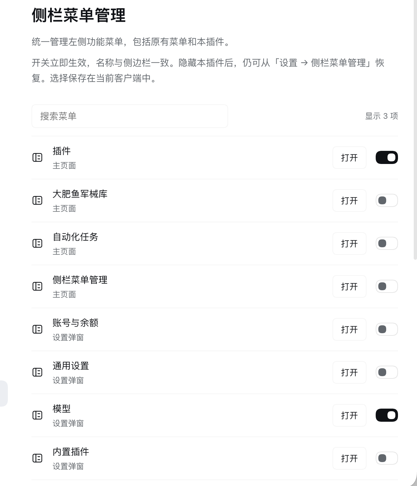
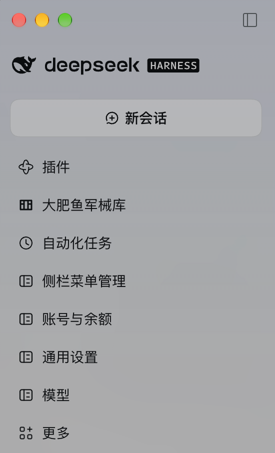

# Sidebar menus for DeepSeek Harness

[简体中文](README.zh-CN.md) · [MIT license](LICENSE)

Show or hide sidebar panel entries and add shortcuts to Settings sections. Existing panels use their actual sidebar names, not the shorter names of their corresponding Settings sections.

## Screenshots

### Manage visibility



### Settings shortcuts in the sidebar



Screenshots show two example configurations. Captured and provided by the plugin author for publication.

## Install

Requires DeepSeek Harness Web or Desktop with the sidebar, Settings and layout client APIs. The plugin ships directly loadable JavaScript: no build, install scripts or additional runtime dependencies. React and the client store are supplied by the Harness module loader.

Ask your Harness agent:

> Install the GitHub plugin github:zyileven/dsh-settings-sidebar

Or install into your active CLI profile (`desktop` below is the Desktop profile; substitute your own):

```sh
dsh plugin --profile desktop add github:zyileven/dsh-settings-sidebar
```

Alternatively, download `dsh-settings-sidebar.tgz` from [Releases](https://github.com/zyileven/dsh-settings-sidebar/releases) and run:

```sh
dsh plugin --profile desktop add ./dsh-settings-sidebar.tgz
```

For a pinned version, use `github:zyileven/dsh-settings-sidebar#v1.3.0`. The package keeps its internal identifier `@local/dsh-settings-sidebar`; it is distributed through GitHub/tarballs, not npm.

## Use

1. Open **Sidebar menus** from the sidebar or Settings.
2. Search for a menu and toggle its visibility. Existing panels, More and the manager itself are included.
3. If you hide the manager, reopen **Settings → Sidebar menus** to restore it.

Where a menu opens depends on whether its content has a main page. Entries with their own main-content page open that page in the main content area, exactly as the original sidebar button does; entries that exist only as a Settings section have no main page, so they open the Settings dialog already positioned on that section. Such a dialog does not replace the page you were on: closing it leaves that page selected, and if that page's plugin has been removed the shortcut falls back to the conversation. The Plugins inventory page and the built-in-plugin Settings section are separate entries.

Hiding an entry does not disable its plugin, delete its page or remove its Settings entry. New Session, workspace browsing and account/Settings controls are outside the panel-menu scope; Settings remains available for recovery.

## Data and safety

Visibility choices stay in this client's `localStorage`. No network requests, account/model/Host configuration changes, session-data changes or model tools are added. Preferences do not sync between clients. First-version pins are migrated; failed saves report an error and preserve the current state. Uninstalling removes policy styles and added shortcuts, restoring original panels. Local preferences remain for reinstalls.

## Compatibility and limitations

The current host has no public filter for every original sidebar panel. Original entries are hidden by a stylesheet rendered in `shell.overlay`, scoped to the global navigation and complete button accessibility names. Labels are CSS-string escaped and follow locale changes. The plugin does not read or rewrite other plugins' DOM or replace the sidebar. New Settings shortcuts use ordinary slot registrations and disposers.

- Hiding affects sidebar navigation rows only. More's popup or other locations may still expose the same function.
- Two original entries with exactly the same display name are hidden together.
- The plugin depends on current navigation markup, `layout.panelInfo` subscription and the Settings shell's shared Store `openSection` action. Host upgrades require revalidation. Settings navigation failures are reported in the manager.
- Existing panels default to visible; Settings shortcuts without an existing sidebar entry default to hidden.

The SVG icon is original artwork; the storefront PNG is converted from it. No third-party UI artwork is bundled.

## Development and verification

```sh
npm test
npm pack --ignore-scripts
```

Node's built-in tests cover names, original/self visibility, shortcut lifecycle, persistence/migration, failed storage, preserved modal backgrounds and listener disposal. Installed Desktop checks also exercised original-panel hiding, manager recovery through Settings and closing Models Settings back onto the Plugins page. These checks are not a cross-version compatibility guarantee.

[](https://github.com/deepseek-ai/deepseek-harness)
