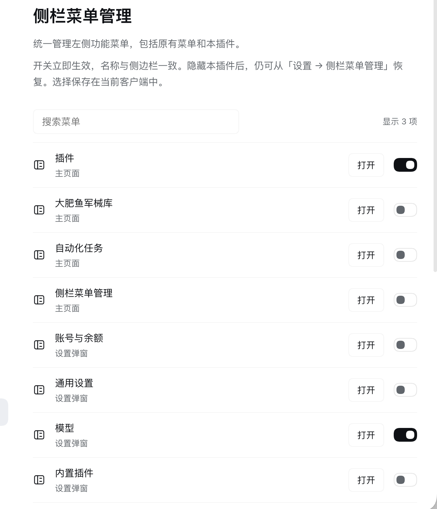
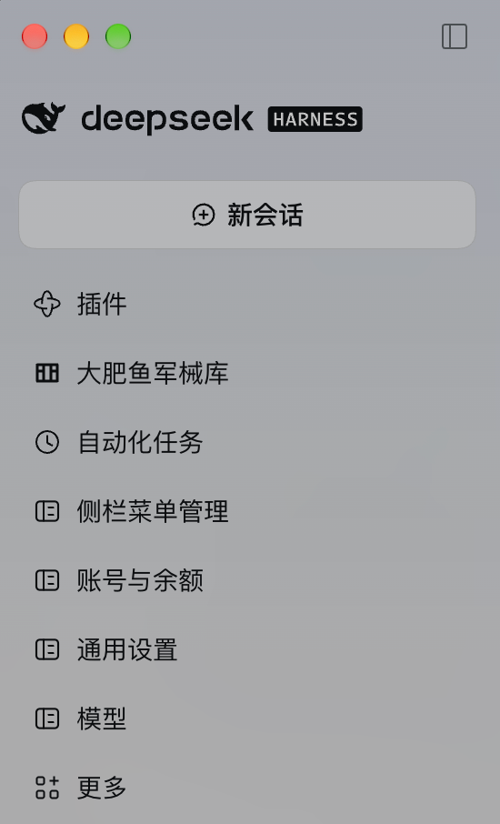

# 侧栏菜单管理

[English](README.md) · [MIT 许可证](LICENSE)

控制 DeepSeek Harness 侧边栏功能菜单的显示，并为设置页面添加快捷入口。菜单名称采用侧边栏实际显示的名称，而不是对应设置项的简称。

## 界面展示

### 逐项管理菜单显隐



### 设置快捷入口显示在侧栏



两张截图展示不同的配置示例，由插件作者截取并提供用于公开介绍。

## 安装

需要提供侧栏、设置和布局客户端接口的 DeepSeek Harness Web 或 Desktop。插件使用可直接加载的 JavaScript，无需构建、额外运行时依赖或安装脚本。React 和客户端 Store 由 Harness 的模块加载器提供。

在 Harness 对话中请求安装：

> 安装 GitHub 插件 github:zyileven/dsh-settings-sidebar

或在 CLI 安装到所用 profile（下面以 Desktop 的 `desktop` 为例，其他 profile 请替换名称）：

```sh
dsh plugin --profile desktop add github:zyileven/dsh-settings-sidebar
```

也可从 [Releases](https://github.com/zyileven/dsh-settings-sidebar/releases) 下载安装包后安装：

```sh
dsh plugin --profile desktop add ./dsh-settings-sidebar.tgz
```

使用固定版本时将 GitHub spec 改为 `github:zyileven/dsh-settings-sidebar#v1.2.0`。本包保留内部标识 `@local/dsh-settings-sidebar`，仅从 GitHub/安装包分发，不发布到 npm。

## 使用

1. 从侧栏或“设置 → 侧栏菜单管理”打开管理页。
2. 搜索菜单并切换开关，立即显示或隐藏。侧栏原有功能菜单、更多及管理插件自身均可控制。
3. 隐藏管理插件自身后，从设置中的同名菜单重新开启。

点击后的去向取决于该菜单是否有主界面内容页：自身有内容页的菜单在主界面内容区域打开该页面，和原侧栏按钮完全一致；只存在于设置里的菜单没有主界面页面，则直接打开设置弹窗并定位到对应菜单项。这种弹窗不会顶掉你当前所在的页面，关闭后仍停留在原页面；若原页面所属插件已卸载，则返回当前会话。“插件”库存页与“内置插件”设置是两个不同入口。

关闭入口不会停用插件、删除页面或隐藏设置弹窗里的菜单。新建会话、工作区浏览、账号/设置按钮是应用操作区，不在控制范围内；保留设置按钮以便恢复隐藏项。

## 数据与安全

只在当前客户端的 `localStorage` 保存菜单显隐，不修改账户、模型、Host 配置或会话数据，不发送网络请求，不添加模型工具。设置不会同步到其他浏览器。升级读取第一版已固定菜单；存储失败显示错误并保持原状态。卸载移除样式和新增快捷入口，恢复原生菜单；本地偏好保留供重新安装使用。

## 兼容性与限制

当前宿主没有过滤全部原生侧栏菜单的公开接口。因此原生菜单通过 `shell.overlay` 中的样式按全局导航和按钮完整无障碍名称隐藏，不读取或改写其他插件的 DOM、不替换侧栏。名称按 CSS 字符串转义，语言变化时更新。新增设置快捷入口通过普通插槽注册与释放。

- 隐藏只影响侧栏导航行；“更多”弹出菜单或其他位置仍可能提供原功能。
- 两个原生入口名称完全相同时，按名称匹配会一起隐藏。
- 依赖当前宿主导航标记、`layout.panelInfo` 订阅和设置壳共享 Store 的 `openSection` 动作。宿主升级后需重新验证；无法打开设置时显示错误。
- 默认保留原有菜单；没有原生侧栏入口的设置快捷项默认关闭。

SVG 图标为本插件原创，市场 PNG 由该图标转换。界面未包含第三方图片。

## 开发与验证

```sh
npm test
npm pack --ignore-scripts
```

测试使用 Node 内置测试运行器，覆盖名称、原生与自身入口开关、快捷入口生命周期、持久化与迁移、存储错误、弹窗背景保留和订阅释放。另在已安装的 Desktop 中实测过原生菜单隐藏、从设置恢复管理入口，以及关闭模型设置后仍停留在插件页。测试不等于跨版本兼容保证。

[](https://github.com/deepseek-ai/deepseek-harness)
